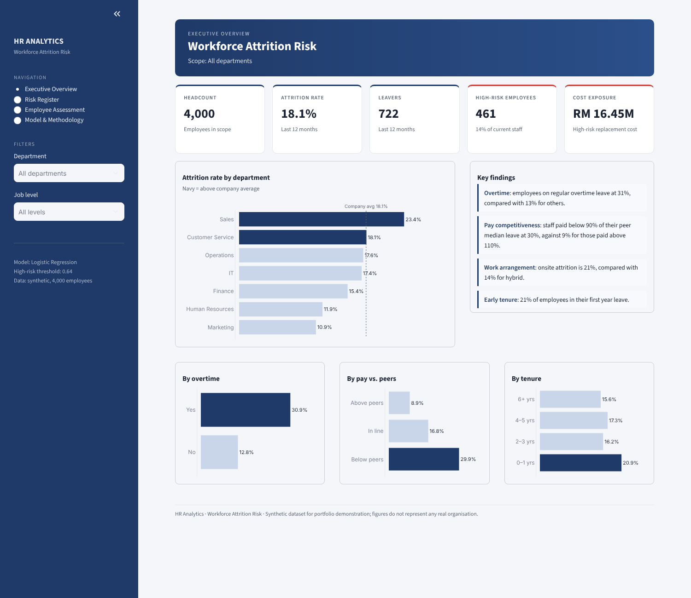
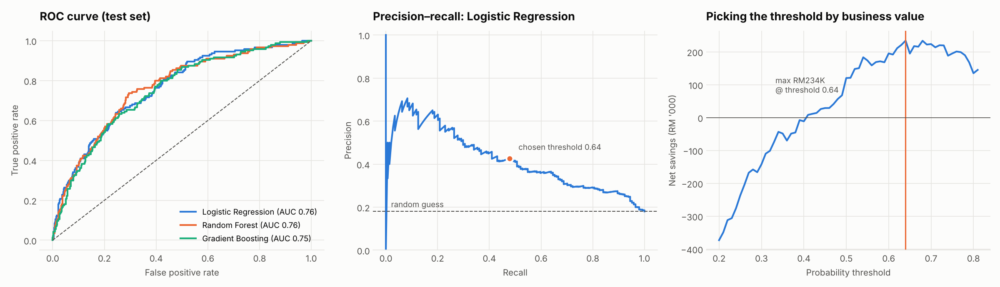

# Employee Attrition Prediction

A machine learning project that predicts **which employees are likely to resign**, explains **why**, and estimates **how much money a targeted retention programme could save**. The results are served through an interactive Streamlit app for HR teams.




---

## Problem

Replacing an employee costs roughly **6 months of their salary** (recruitment, onboarding, lost productivity). The company in this project has an **18% annual attrition rate** across 4,000 staff.

HR wants to know three things:
1. **Who** is most likely to leave next?
2. **Why?** What can the company actually change?
3. **Is a retention programme worth it**, and how many people should it target?

## Results

| | |
|---|---|
| **Best model** | Logistic Regression (beat Random Forest and Gradient Boosting in cross-validation) |
| **ROC-AUC (test)** | **0.76** |
| **PR-AUC (test)** | **0.42**, 2.3× better than random (0.18) |
| **Decision threshold** | 0.64, chosen to **maximise net savings**, not accuracy |
| **At that threshold** | 48% of actual leavers caught, and 43% of flagged employees really leave |
| **Estimated net savings** | **~RM1.17M** if applied across the whole workforce |



### Why did the simplest model win?

| Model | 5-fold CV ROC-AUC |
|---|---|
| **Logistic Regression** | **0.763 ± 0.014** |
| Random Forest | 0.743 ± 0.028 |
| Gradient Boosting | 0.727 ± 0.023 |

The attrition drivers are mostly **additive** (overtime + underpaid + stagnant = high risk). A linear model captures that well and overfits less. It is also **fully explainable**: HR can see exactly why each person was flagged. That matters when the output affects real people.

## What drives attrition?


| Driver | Effect |
|---|---|
| **Regular overtime** | Attrition 31% vs 13%. Odds of leaving **3.9× higher**. |
| **Paid below peers** (same dept & level) | 30% attrition vs 9% for those paid above peers. This is the #1 predictor. |
| **Onsite-only work** | 21%, vs 14% for hybrid |
| **New joiners (≤1 year)** | 21%, which points to onboarding problems |
| **Sales department** | Highest attrition, at 23% |

**Feature engineering made the difference.** Raw `monthly_income` is a weak signal, because a Level 1 employee earning RM3,000 might be paid fairly. The engineered feature **`pay_vs_peer_median`** (salary ÷ median of the same department and level) became the strongest predictor.

## Recommendations

1. **Audit pay for the 461 current employees flagged as high risk.** Their median pay is 90% of their peer median.
2. **Cap chronic overtime.** 68% of high-risk employees do regular overtime. In the app's what-if example, removing overtime alone cuts the risk score from 0.93 to 0.79.
3. **Offer hybrid work** to onsite roles where possible.
4. **Strengthen onboarding** with a 90-day buddy system and check-ins at months 3, 6 and 12.
5. **Use the model to prioritise, not to decide.** It flags people for a conversation with their manager. It should never drive automatic decisions.

## How the savings were estimated

```
Net savings = (leavers correctly flagged × 6 months' salary × 30% retention success)
            − (everyone flagged × RM3,000 intervention cost)
```

The threshold was swept from 0.20 to 0.80, and the one that **maximised net savings** was chosen (right-hand chart above). A lower threshold catches more leavers but wastes money on false alarms. A higher one misses too many. All of these assumptions are constants at the top of `src/train.py`, so you can change them.

##  The app

`streamlit run app/app.py`

| Page | What it does |
|---|---|
| Executive Overview | KPIs (headcount, attrition rate, high-risk staff, replacement-cost exposure), attrition by department and by key drivers, key findings |
| Risk Register | Ranked list of current staff with risk scores. Filter by department, job level or risk band and export to CSV. |
| Employee Assessment | Enter a profile to get a risk gauge, the **main drivers for that person** and **intervention scenarios** (remove overtime, +15% pay, hybrid, promotion) |
| Model & Methodology | Model comparison, confusion matrix, top predictors and business assumptions |


## Project structure

```
hr-attrition-prediction/
├── app/app.py                  # Streamlit app
├── src/
│   ├── generate_data.py        # synthetic HR dataset (4,000 employees)
│   ├── features.py             # feature engineering (shared by training + app)
│   ├── eda.py                  # attrition-rate analysis + charts
│   ├── train.py                # CV model comparison, threshold tuning, importance
│   └── style.py                # chart palette
├── reports/
│   ├── metrics.json            # test-set results
│   ├── model_comparison.csv
│   ├── feature_importance.csv
│   ├── logistic_odds_ratios.csv
│   ├── eda_attrition_rates.csv
│   └── current_employee_risk.csv
├── images/                     # charts for this README
├── run_pipeline.py             # rebuild everything in one command
└── requirements.txt
```

## How to run

```bash
git clone https://github.com/<your-username>/hr-attrition-prediction.git
cd hr-attrition-prediction
python -m venv venv && source venv/bin/activate     # Windows: venv\Scripts\activate
pip install -r requirements.txt

python run_pipeline.py          # data → EDA → train (~30 s)
streamlit run app/app.py
```

The app trains the model automatically the first time it runs, so it can be deployed straight to **Streamlit Community Cloud**.

##  Methods and good practice

- **Stratified train/test split**, so the 18% leaver ratio is the same in both sets
- **No data leakage:** peer-median salaries are learned on the training set only and then applied to the test set and the app
- **Pipelines** (`ColumnTransformer` + model), so preprocessing is identical in training and prediction
- **Class imbalance** handled with `class_weight="balanced"` and evaluated with PR-AUC, not accuracy
- **Permutation importance** (model-agnostic) plus **odds ratios** (logistic regression)
- **Per-employee explanations** from logistic-regression contributions

## Limitations and ethics

- The data is **synthetic**. It was generated with realistic, documented drivers (see `src/generate_data.py`) and does not describe a real company.
- Gender and marital status were included for analysis but **should be reviewed for fairness** before real use. A production model should be audited for bias across groups.
- Risk scores come from a class-balanced model, so use them to **rank** employees, not as exact probabilities.

##  Next steps

- Survival analysis (time-to-exit) instead of a yes/no label
- SHAP values for the tree models
- Calibrated probabilities (Platt / isotonic scaling)
- Fairness metrics by gender and age group

---

